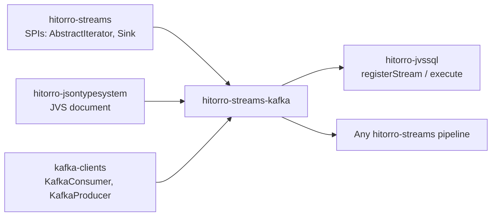

# hitorro-streams-kafka

Kafka source (`Iterator<JVS>` / `Iterator<ConsumerRecord>`) and sink
(`Sink<JsonNode>`) for the [hitorro-streams](https://github.com/geekychris/hitorro-streams)
pipeline framework. Wraps the standard `org.apache.kafka:kafka-clients`
library.

## Position



Depends on `hitorro-core` + `hitorro-streams` + `hitorro-jsontypesystem` +
`kafka-clients`. Users of the module only pay the Kafka client cost — every
other `hitorro-streams` consumer stays lean.

## Quick example

```java
import com.hitorro.streams.kafka.KafkaSource;
import com.hitorro.streams.kafka.KafkaSink;
import com.hitorro.jvssql.JvsSqlEngine;
import java.time.Duration;

// Source — Kafka topic as an Iterator<JVS>
try (KafkaSource src = KafkaSource.builder()
        .bootstrapServers("localhost:9092")
        .topic("events")
        .groupId("my-app")
        .autoOffsetReset("earliest")
        .pollTimeout(Duration.ofSeconds(1))
        .build()) {

    JvsSqlEngine engine = JvsSqlEngine.builder()
        .registerStream("events", src.asJvsIterator(), eventType)
        .build();

    // Sink — pipe query results back to Kafka
    KafkaSink out = KafkaSink.builder()
        .bootstrapServers("localhost:9092")
        .topic("enriched-events")
        .keyExtractor(row -> row.path("user_id").asText())
        .build();

    engine.compile("""
        SELECT user_id, COUNT(*) AS n, SUM(bytes) AS total
        FROM events
        GROUP BY user_id
        """).execute(out);
}
```

## Building

```bash
# from reactor root
mvn install -DskipTests -pl hitorro-streams-kafka -am
```

Java 21 required.

## Notes

- **Serialization** — `StringSerializer` / `StringDeserializer` are hardcoded
  in v1. Payload is expected to be JSON; the source parses it with Jackson
  before wrapping in a `JVS`. For Avro/Protobuf, wrap your own deserializer
  and use `asRecordIterator()` for raw access.
- **Offset commits** — auto-commit is on by default. For at-least-once with
  your own commit boundaries, set `.autoCommit(false)` and call the consumer's
  commit APIs from your own code (currently means dropping down to
  `asRecordIterator()` and accessing the underlying consumer via the builder).
- **Backpressure** — the source blocks on `hasNext()` while polling. In a
  hitorro-streams pipeline this naturally applies backpressure — the consumer
  stalls when downstream is slow.
- **Shutdown** — `close()` on the source calls `consumer.wakeup()` so a
  blocked poll unblocks cleanly.

## License

MIT (see the parent `hitorro-all` repo).
